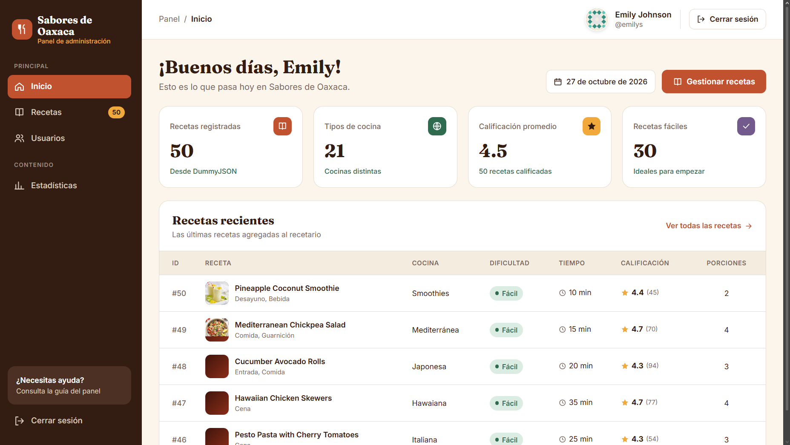
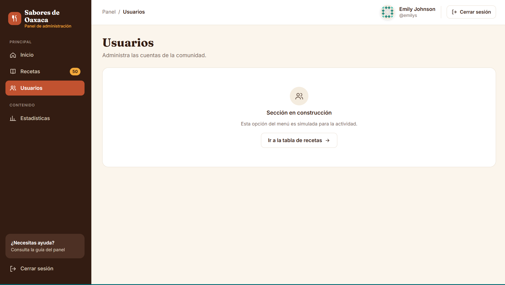
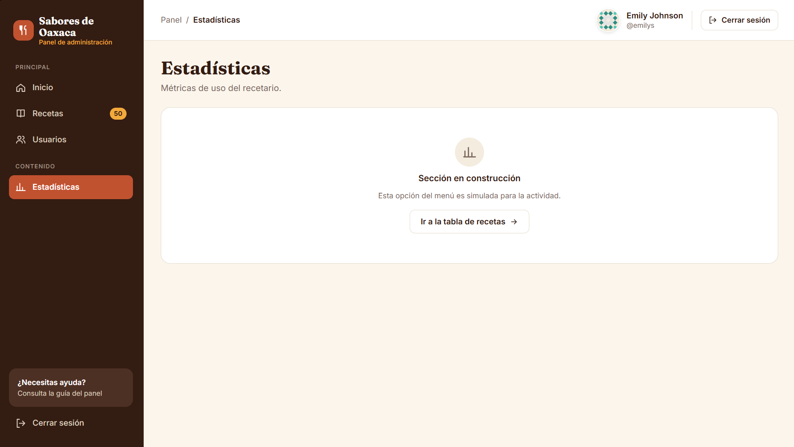

# t3_act8_eq01 · Sabores de Oaxaca — Panel de administración

Mini sistema en **React + Vite** que simula un login real con la API de **DummyJSON** y muestra una **tabla de recetas** con filtros, paginación reflejada en la URL y acciones CRUD (agregar, editar y eliminar).

El diseño sigue el mockup de Figma de la Actividad 7 (paleta barro, mole, cempasúchil y agave).

## Integrantes

| Nombre |
| --- |
| *Hernández Vázquez Alexis* |
| *Aquino Rosales Aleks Jesus* |

## API elegida

- **Login:** `POST https://dummyjson.com/auth/login`
- **Tabla de datos:** **DummyJSON recetas** — `https://dummyjson.com/recipes`
  - Listar: `GET /recipes?limit=0`
  - Agregar: `POST /recipes/add`
  - Editar: `PUT /recipes/:id`
  - Eliminar: `DELETE /recipes/:id`

## Proyecto desplegado

**http://204.48.17.197/t3_act8_eq01/**

## Cuentas de prueba

| Usuario | Contraseña |
| --- | --- |
| `emilys` | `emilyspass` |
| `michaelw` | `michaelwpass` |
| `sophiab` | `sophiabpass` |

También se puede entrar con el **correo** del usuario (ej. `emily.johnson@x.dummyjson.com`).

Más usuarios en https://dummyjson.com/users

---

## Qué hace cada fase

### Fase 1 · Login

- Formulario con usuario (o correo) y contraseña, igual al mockup.
- Validaciones antes de enviar: campos vacíos, formato de correo y longitud mínima.
- Si las credenciales son correctas, el usuario se guarda en el estado (`useState` dentro de `AuthContext`) y se cambia a la vista del sistema. Si no, aparece **"Usuario o contraseña incorrectos."**
- Botón para mostrar/ocultar la contraseña y opción "Recordar sesión".

### Fase 2 · Sistema (sidebar + navbar)

- **Sidebar** con Inicio, Recetas, Usuarios y Estadísticas (estas dos últimas son simuladas) y "Cerrar sesión".
- **Navbar** con la **foto de perfil** (campo `image`), **nombre** del usuario y botón **Cerrar sesión**.
- Las vistas del sistema están protegidas con `ProtectedRoute`: si no hay usuario en el estado, redirige al login (y después de entrar regresa a la página que se intentó abrir).

### Fase 3 · Tabla de recetas

- **Filtros:** búsqueda por nombre (ignora acentos y mayúsculas), tipo de cocina y dificultad.
- **Paginación:** botones Anterior / Siguiente, números de página y selector de **10, 20, 40 o 50** registros.
- **URL:** página, límite y filtros viven en la URL, por ejemplo `/t3_act8_eq01/recetas?page=2&limit=20&cuisine=Italian`. El enlace se puede compartir y el botón "atrás" del navegador funciona.
- **Estados:** indicador "Cargando recetas…" y mensaje de error con botón "Reintentar" si la petición falla.
- **CRUD:**
  - **Agregar:** formulario con validación → `POST /recipes/add` → se agrega al estado local.
  - **Editar:** formulario → **confirmación** → `PUT /recipes/:id` → se actualiza en el estado local.
  - **Eliminar:** **confirmación** → `DELETE /recipes/:id` → se quita del estado local.
  - Cada acción muestra un aviso con lo que respondió la API, y la respuesta completa se imprime en la consola.

> **Nota sobre DummyJSON:** la API solo *simula* las escrituras. Por eso primero se hace la petición real y después se refleja el cambio en el estado local. Además, `POST /recipes/add` siempre responde con el mismo `id`, así que la app genera un id único local. Si editas o eliminas una receta creada en la sesión, la API responde 404 (no la conoce) y el cambio se aplica solo en la tabla, avisándolo al usuario.

---

## Estructura del proyecto

```text
src/
├── components/
│   ├── layout/        AppLayout, Sidebar, Navbar, ProtectedRoute
│   ├── recipes/       RecipeFormModal, RecipeThumb, DifficultyBadge
│   ├── table/         RecipesTable, TableFilters, Pagination
│   └── ui/            Modal, ConfirmDialog, Toast, Avatar, Icon, Logo, StatusMessages
├── context/           AuthContext (usuario en useState), RecipesContext (recetas + CRUD)
├── hooks/             useAuth, useRecipes, useTableParams (estado de la tabla en la URL)
├── pages/             LoginPage, DashboardPage, RecipesPage, PlaceholderPage
├── services/          api.js  ← todas las llamadas a DummyJSON
├── styles/            global.css
├── utils/             recipes.js (formato y validación), pagination.js
├── App.jsx            rutas
└── main.jsx           punto de entrada
```
## Capturas del sistema

### Acceso


### Panel Principal


### Gestión y CRUD de Recetas


### Vistas Adicionales



## Correr en local

```bash
npm install
npm run dev
```

Abre la URL que muestra la terminal (ej. `http://localhost:5173/t3_act8_eq01/`).

---

## Despliegue en el VPS (Fase 4)

### 1. Preparar el servidor (DigitalOcean)

Se creó un Droplet con Ubuntu Server y se instaló Nginx.

### 2. Generar el build

```bash
npm run build
```

Se crea la carpeta `dist/`.

### 3. Subir `dist` al servidor

Transferir la carpeta al VPS por SSH:

```bash
scp -r dist root@204.48.17.197:~/
```

Conectarse al servidor:

```bash
ssh root@204.48.17.197
```

Crear la ruta web en el VPS:

```bash
mkdir -p /var/www/html/t3_act8_eq01
```

Copiar los archivos de compilación:

```bash
cp -r ~/dist/* /var/www/html/t3_act8_eq01/
```

### 4. Configurar Nginx para las rutas de React

Para evitar errores 404 al recargar o compartir enlaces con parámetros, se editó el archivo `/etc/nginx/sites-available/default`, agregando el siguiente bloque dentro de `server {`:

```nginx
location /t3_act8_eq01/ {
    try_files $uri $uri/ /t3_act8_eq01/index.html;
}
```

Luego se aplicaron los cambios:

```bash
nginx -t
systemctl reload nginx
```

### 5. Verificar

Ingresar a [http://204.48.17.197/t3_act8_eq01/](http://204.48.17.197/t3_act8_eq01/) para comprobar el inicio de sesión y la navegación.
